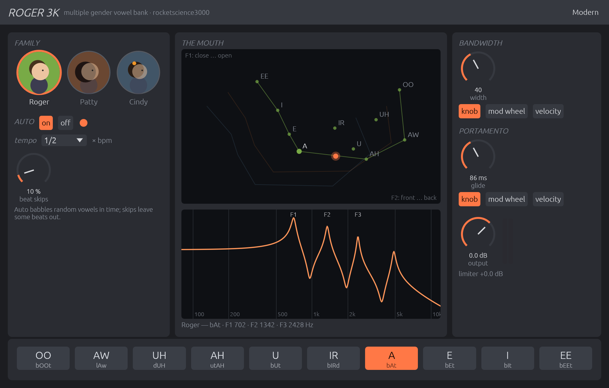
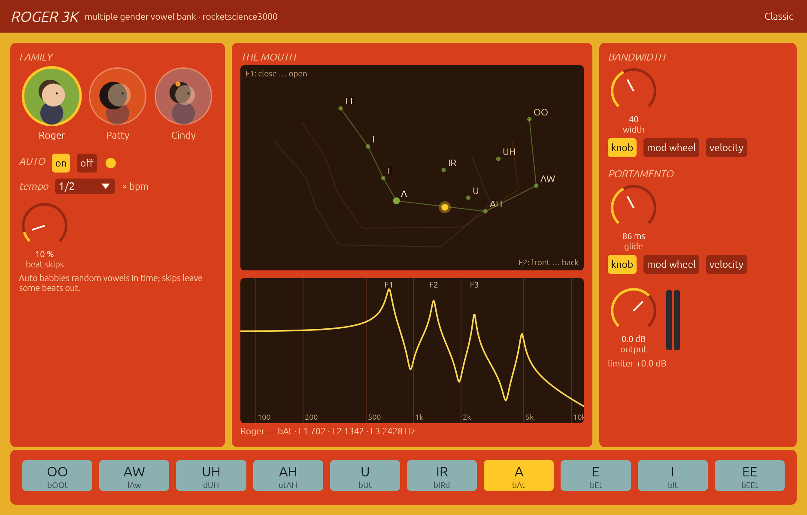
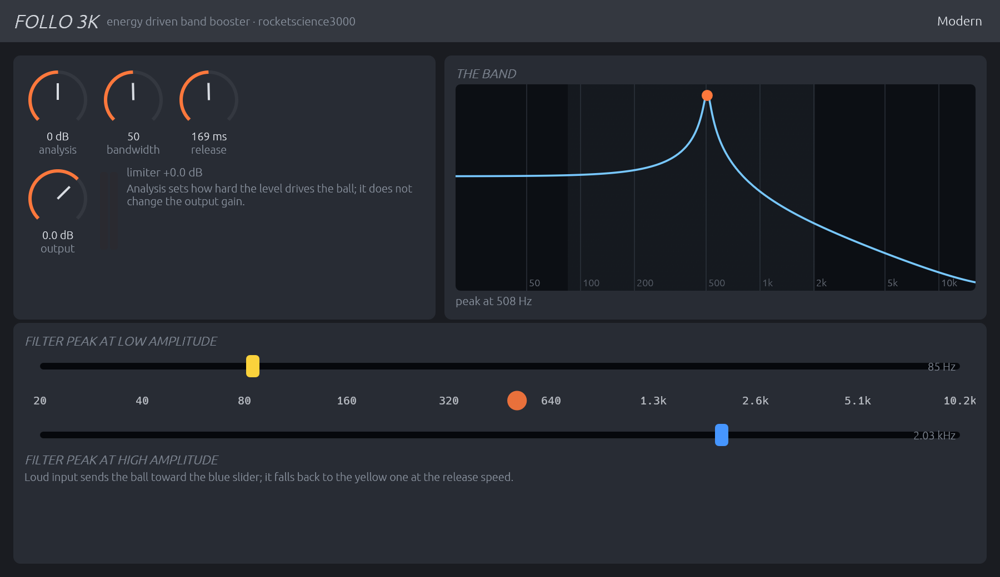
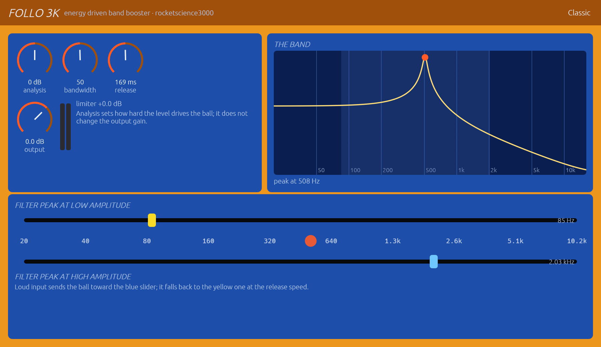
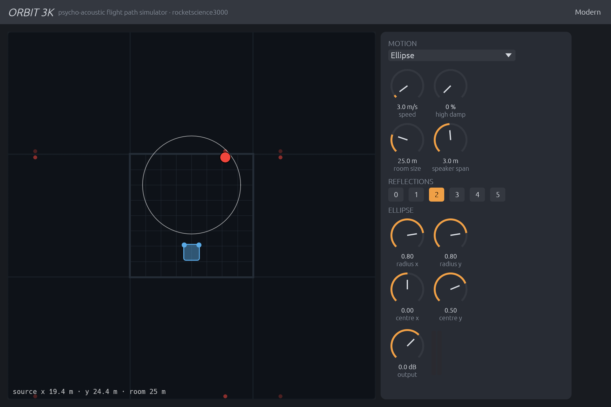
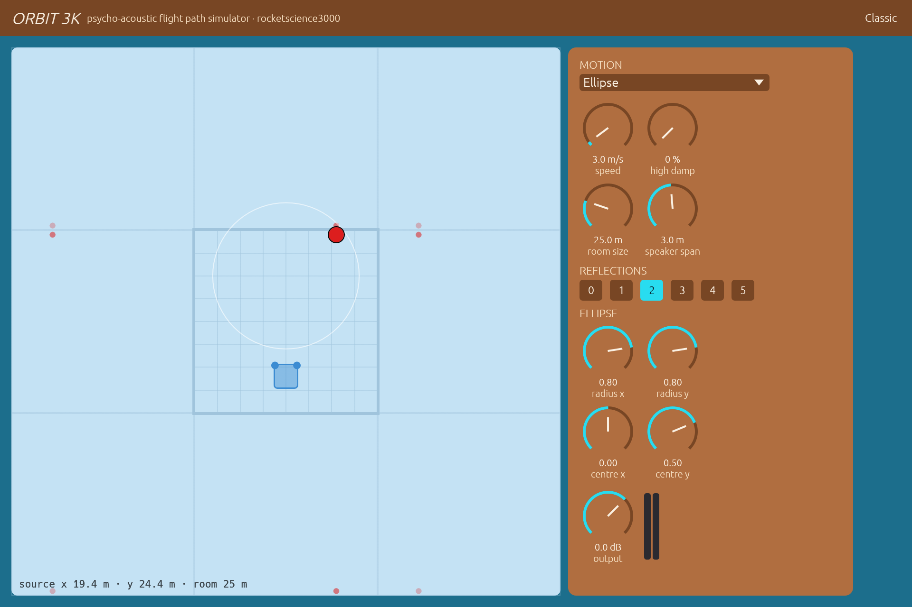

# rocketscience3000

```
 ___  ___   ___ _  _____ _____   ___  ___ ___ ___ _  _  ___ ___   ____ __   __   __
| _ \/ _ \ / __| |/ / __|_   _| / __|/ __|_ _| __| \| |/ __| __| |__ //  \ /  \ /  \
|   / (_) | (__| ' <| _|  | |   \__ \ (__ | || _|| .` | (__| _|   |_ \ () | () | () |
|_|_\\___/ \___|_|\_\___| |_|   |___/\___|___|___|_|\_|\___|___| |___/\__/ \__/ \__/

  AUDIO EASE ROCKET SCIENCE 2001–2013 • REBUILT FROM THE ORIGINAL BINARIES
                       Roger3K · Follo3K · Orbit3K
```

A modern recreation of **Audio Ease's Rocket Science bundle**: three plug-ins
that started out in 2001 as MAS plug-ins for Digital Performer on Mac OS 9 —
a vowel filter, an envelope-driven resonator and a flight-path simulator —
each rebuilt in Rust from the original machine code with the
[truce](https://github.com/truce-audio/truce) framework, with a new resizable
editor (Modern and Classic themes). A sibling of
[nautilus3000](https://github.com/nagualcode/nautilus3000) (Riverrun, Deep
Phase Nine, PeriScope) and [th0nk3000](https://github.com/nagualcode/th0nk3000).

| Plug-in | What it is | Status |
|---|---|---|
| [**Roger3K**](#roger3k--multiple-gender-vowel-bank) | vowel filter: ten vowels, three voices, tempo-synced babble | ✅ engine bit-identical to the original (55/55); plug-in, editor, CLI |
| [**Follo3K**](#follo3k--energy-driven-band-booster) | "energy driven band booster": a resonator whose peak follows the input level — auto-wah, thumping bass | ✅ engine bit-identical to the original (41/41); plug-in, editor, CLI |
| [**Orbit3K**](#orbit3k--psycho-acoustic-flight-path-simulator) | "psycho-acoustic flight path simulator": a source moving in a virtual room, reflections and Doppler | ✅ engine bit-identical to the original (39/39); plug-in, editor, CLI |

"Bit-identical": the original 3.6.2 machine code runs in a CPU emulator, fed
the same audio, settings, MIDI and tempo as the Rust engine, and the outputs
are compared float for float — see [How faithful is it?](#how-faithful-is-it).

---

## Installing

Release builds (macOS Apple Silicon: AU, VST3, CLAP; Linux: CLAP, VST3, LV2;
Windows: CLAP, VST3; each with standalone apps and CLI renderers) are built by
GitHub Actions for every tagged version and attached to the
[Releases](https://github.com/nagualcode/rocketscience3000/releases). The
macOS builds are not notarised: clear the quarantine flag with
`xattr -dr com.apple.quarantine <bundle>`. Or build from source (see
[Building](#building)):

```bash
cargo truce install --au2 --user        # AU only, into ~/Library/Audio/Plug-Ins/Components
cargo truce install --clap --vst3 --user
```

The plug-ins are **effects that accept MIDI** (vendor *Jardim Sonoro*). Put
Roger3K on an audio track; to play it from a keyboard, route a MIDI track to
it (in Logic: load it in an instrument slot and feed the audio through the
side-chain). Channels: mono, mono→stereo, stereo. Latency: 300 samples (the
look-ahead of the original limiter), reported to the host.

---

## Roger3K — multiple gender vowel bank



> *You can apply human vowel sounds to your audio with Roger. Use the vowel bar
> at the bottom to click through the vowels and click the portrait to select one
> of the Roger family members.* — Audio Ease

### The idea

A vowel is a sound passed through a mouth: the throat and tongue make
resonances — **formants** — and their frequencies tell an "ee" from an "ah".
Roger puts your audio through four resonators tuned like a mouth. The tunings
come from the classic study of vowels, Peterson & Barney (1952): ten vowels
measured on men, women and children — here **Roger**, **Patty** and **Cindy**.
Feed it anything with a rich spectrum — a synth pad, a drum loop, a distorted
guitar, white noise — and it starts to talk.

### Walk-through

**1. Pick a voice.** Click a portrait: Roger (a man's formants), Patty (a
woman's), Cindy (a child's — everything higher).

**2. Pick a vowel.** The **vowel bar** at the bottom: OO (b*oo*t), AW (l*aw*),
UH (d*u*h), AH (ut*ah*), U (b*u*t), IR (b*ir*d), A (b*a*t), E (b*e*t), I (b*i*t),
EE (b*ee*t). Click one, or **drag across the bar** to rattle through them.

**3. The mouth.** The chart shows the vowels as phoneticians draw them — F2
(front ↔ back of the tongue) across, F1 (closed ↔ open mouth) down — with the
voice's ten vowels joined up and the orange dot where Roger is *now*; below it
the filter's actual response with its peaks F1, F2, F3.

**4. Shape it.**

| Control | What it does |
|---|---|
| **Bandwidth** | how sharp the formants are. Low: narrow peaks that **whistle** (and keep ringing after the input stops — the limiter keeps them in check). Mid: a clear vowel. Above about 56 the filter stops widening and the dry sound fades in; at 100 the output is unfiltered |
| **Portamento** | how long a vowel takes to turn into the next: about 6 ms at 1 (almost a click), 86 ms at 40, 5 s at 100 |
| knob / mod wheel / velocity | under each knob: drive bandwidth or portamento from the knob, the modulation wheel (CC 1), or the **velocity** of the MIDI notes (hard hits = sharp, fast vowels) |

**5. Let it babble.** **Auto** makes the family talk random nonsense in time
with the host: **tempo** sets vowels per beat (1/16 … 16 — "1/2" is one vowel
every two beats, "4" four per beat), **beat skips** the percentage of beats
left out, which is what turns babble into a groove. The light flashes on
every new vowel. *Auto is on by default, as in the original.* Clicks in the
vowel bar, notes and automation still work while it runs.

**Mono → stereo**: the left output gets the vowel, the right one the
*residue* — what the vowel filter took away. Strange, and very wide.

### MIDI

Notes play the mouth: within each octave the twelve keys map onto the ten
vowels (C and C♯ OO, D AW, D♯ UH, E AH, F U, F♯ IR, G and G♯ A, A E, A♯ I,
B EE), and the octave picks the voice — **Roger** from note 48, **Patty** from
60, **Cindy** from 72, repeating up and down the keyboard. The manual's tip:
pipe a host or synth **arpeggiator** into Roger for grooves that stay locked to
the song. CC 1 and velocity drive bandwidth / portamento when their mode is set
so. Values set by notes and Auto hold until the host moves the parameter.

### Recipes

* **Talking pad** — a wide saw pad, Roger or Patty, bandwidth 25–35,
  portamento 60–70, automate the vowel (or play notes) slowly.
* **Robot babble** — drum loop or noise, Auto on at 2 per beat, skips 30 %,
  portamento 20, Cindy for a toy voice.
* **Whistling choir** — bandwidth 1–5 on a sustained chord: the formants ring
  like glass; switch vowels for a melody of overtones.
* **Wah-wah on velocity** — guitar or clav, width mode *velocity*, and play the
  vowels AH/OO from a keyboard as you play.
* **Stereo ghost** — mono→stereo on a vocal: the vowel on the left, its
  shadow on the right.

Classic theme (the original's gold case and red panels):



### Command line

```bash
roger-render in.wav out.wav --family 1 --vowel 3 --bandwidth 30
roger-render drums.wav out.wav --auto --speed 6 --skip 25 --bpm 120 --portamento 20
```

---

## Follo3K — energy driven band booster



> *Follo dynamically adjusts the peak of a resonating bandpass filter according
> to the level of the incoming audio.* — Audio Ease

### The idea

An auto-wah: one sharp, resonant band whose frequency is pushed by how loud
you play. Quiet, it rests on the **yellow** slider; loud, it flies to the
**blue** one; when you stop, it falls back at the **release** speed. Set the
blue slider *below* the yellow one and loud notes pull the band *down*; set
both low and narrow and every hit becomes a thump of resonating bass.

### Walk-through

| Control | What it does |
|---|---|
| **Filter peak at low amplitude** (yellow, top strip) | where the band sits when the input is quiet — 20 Hz to 10.2 kHz in tenths of a semitone |
| **Filter peak at high amplitude** (blue, bottom strip) | where the band goes when the input is loud (full scale and above) |
| the ball | where the band is now |
| **Analysis** | sensitivity of the level detector, −12…+12 dB: high settings make the ball hit the blue slider often. It does not change the output level |
| **Bandwidth** | from a razor-thin, whistling band (1: 0.07 semitone) through 2.5 semitones at 50 to a wide open filter at 100 |
| **Release** | how fast the ball falls back: 40 ms to 3 s (169 ms at 50) |
| **Output** | (3K) output trim |

The band display shows the filter's actual response around the ball. Mono and
stereo Follo move the band with the *square* of the level (it stays near the
yellow slider until you play loud); the **mono→stereo** Follo moves it
linearly and sends the band left and everything else right — Audio Ease's
advice: try it on synth basses, it does strange things to the stereo image. A
look-ahead limiter (300 samples) keeps the resonances in check.

**MIDI**: CC 11 analysis (or "drive"), 12 bandwidth, 13 release, 14 yellow
slider, 15 blue slider.

### Recipes

* **Classic auto-wah** — guitar or clav: yellow at ~300 Hz, blue at ~2 kHz,
  bandwidth 30–40, release 40, analysis to taste.
* **Thumping bass** — kick or bass: yellow at 40 Hz, blue at 120 Hz,
  bandwidth 5–10, analysis +12: the band slams into the blue slider on every
  hit and rings.
* **Reverse wah** — blue *below* yellow: loud notes close the filter.
* **Stereo smear** — mono→stereo on a synth bass, bandwidth 20, release 70.



```bash
follo-render bass.wav out.wav --low 40 --high 200 --bandwidth 8 --analysis 12
```

---

## Orbit3K — psycho-acoustic flight path simulator



> *Orbit lets you control the virtual position of your sound source. It
> accurately calculates the sound source's reflections of the walls of a
> virtual 'outer room', using the exact amount of delay and attenuation for
> the direct sound and all reflections alike.* — Audio Ease

### The idea

A sound flying around you in a room. Orbit computes what your two ears would
hear: the direct sound and its reflections off the four walls (up to the fifth
order — 61 paths per ear), each arriving with its own delay at 340 m/s, its
own loudness (distance, walls, the shadow of your head) and its own **Doppler
shift** — coming closer it rises in pitch, going away it falls, and every
reflection does so separately. This is F. R. Moore's classic 1983 model of
spatial sound. Use it as a physically correct panner, or let the source fly.

### Walk-through

**The room** (seen from above, "forward" is up): the tiled square is the
**outer room**, the light-blue square is the **inner room** where you sit — its
top corners are your ears, a *speaker span* apart. The red ball is the source,
the trail where it has been; faint dots are its mirror images in the walls,
which is where the reflections seem to come from. Drag the inner room to move
the listener.

| Control | What it does |
|---|---|
| **Motion** | *Static* — the source sits where you click; *Follow clicks* — it flies to every point you click, cutting corners, at the set speed; *Ellipse* / *Ellipse backwards* — it circles the white ellipse; *Buck Rogers on LSD* — it darts at random inside the ellipse |
| **Speed** | 0–99 m/s. Fast flights give strong Doppler sweeps |
| **Room size** | 8–80 m: bigger rooms, later and more spread reflections |
| **Speaker span** | 0.2–6 m between your ears / speakers: how wide the stereo image is |
| **Reflections** | 0 (direct sound only) to 5 orders of reflections |
| **High Damp** | how much the walls swallow the highs (the direct sound stays bright) |
| **Ellipse** | radius and centre of the orbit |
| **Output** | (3K) output trim |

**MIDI**: CC 11 room size, 12 / 13 listener Y / X, 14 high damp, 15 speed,
16 / 17 ellipse radius, 18 / 19 ellipse position, 20 speaker span, CC 1 the Y
target; **notes** steer the source — the key picks X (C2 at the left wall,
five octaves across), the velocity Y; **pitch bend** sweeps X; **program
change** picks the motion.

### Recipes

* **Fly-by** — Follow clicks, speed 40–70, room 40, reflections 1: click left
  of the listener, then far right: the Doppler swoosh of a passing car.
* **Slow orbit** — Ellipse, speed 2–4, reflections 3, high damp 40: a voice
  walking around you in a hall.
* **Insect** — Buck Rogers on LSD, speed 30, small ellipse, room 8: a fly
  buzzing around your head.
* **Static placement** — Static, reflections 2: a dry mono source placed in a
  room, with real early reflections instead of panning.



```bash
orbit-render voice.wav out.wav --mode 3 --speed 8 --room 30 --order 3 --damp 30
```

---

## How faithful is it?

**Bit for bit.** Each engine is a translation of the i386 slice of the 3.6.2 plug-in. The original machine code — `InitBuffers`, `Process`,
`ReceiveMidi`, its own parameter objects and host-time context — runs under
the Unicorn CPU emulator:

```
55 scenarios — every voice, vowels, bandwidth 1…100 and glides, portamento,
all 12 Auto speeds, skips, tempi, MIDI notes / velocity / mod wheel, mono,
mono→stereo, stereo, blocks of 64…1024, a million samples, 22.05…96 kHz:
55 identical, 0 different
```

Kept quirks: a fourth formant an octave above the third; wet/dry from the
last control tick of each buffer; a random generator that starts from
uninitialised memory; with no host tempo, Auto changes vowel on every sample
(the host-time object sets its tempo before it knows the sample rate); and
2π typed as 6.2831853056 — the same typo as in PeriScope, by the same hand.
The Mac OS 9 Roger (v2.04) carries the identical vowel table, bit for bit.
Follo: **41 scenarios, 41 identical** (layouts, bandwidth, release,
analysis, sliders, MIDI CCs, block sizes, sample rates); its quirks: the band
moves with the level in mono→stereo but with its square in mono and stereo,
and both mistyped π constants. Orbit: **39 scenarios, 39 identical**
(every motion, reflection orders 0–5, rooms 8–80 m, damping, MIDI, block sizes,
8–96 kHz); its quirks: a Doppler resampler that reads up to two samples past
its input (the original read whatever followed in memory; the port reads
zeros), reflections attenuated with `exp` where `pow(10, …)` was meant, and an
80 m room whose farthest reflections wrap around the delay line. Details,
addresses and the emulators in
**[reverse_engineering/roger](reverse_engineering/roger/README.md)**,
**[reverse_engineering/follo](reverse_engineering/follo/README.md)** and
**[reverse_engineering/orbit](reverse_engineering/orbit/README.md)**.

---

## Building

Requirements: Rust 1.85+ and [`cargo-truce`](https://github.com/truce-audio/truce).

```bash
cargo test --release
cargo run --release -p roger --bin roger-standalone
cargo truce install --au2 --user && auval -v aumf Rogr JdSn && auval -v aumf Folo JdSn && auval -v aumf Orbt JdSn
python3 reverse_engineering/roger/tools/differential_test.py \
    reverse_engineering/roger/original_binaries/Roger-3.6.2-VST-i386 target/release/roger-render /tmp/roger
```

## Repository

```
rocketscience3000/
├── crates/mission/      # Audio Ease "Mission" pieces: AGC / limiter, breakpoint
│                        #   tables, ring buffer, vecLib FFT, denormal flush
├── plugins/roger/       # Roger3K: engine, vowel table, params, editor, roger-render
├── plugins/follo/       # Follo3K: engine, params, editor, follo-render
├── plugins/orbit/       # Orbit3K: room model, Doppler delay line, motions, editor, orbit-render
├── reverse_engineering/
│   ├── tools/           # Ghidra script, Mach-O / PEF helpers, asm annotator, Unicorn harness
│   ├── roger/           # write-up, original binaries, decompiled code, emulator, test
│   ├── follo/           # the same for Follo
│   └── orbit/           # the same for Orbit
├── reference/           # the original material: Mac OS 9 plug-ins and manual,
│                        #   OS X installer and manual, review
└── docs/                # screenshots
```

## License and credits

- Modern implementation: MIT © 2026 nagualcode / Jardim Sonoro.
- Roger, Follo, Orbit: © 2001–2013 **Audio Ease B.V.**; interface design by
  Oskar Luyer.
- Vowel data: G. E. Peterson & H. L. Barney, "Control methods used in a study
  of the vowels", JASA 24 (1952).
- Audio plug-in framework: [truce](https://github.com/truce-audio/truce).
- An independent preservation project, not affiliated with or endorsed by
  Audio Ease.
